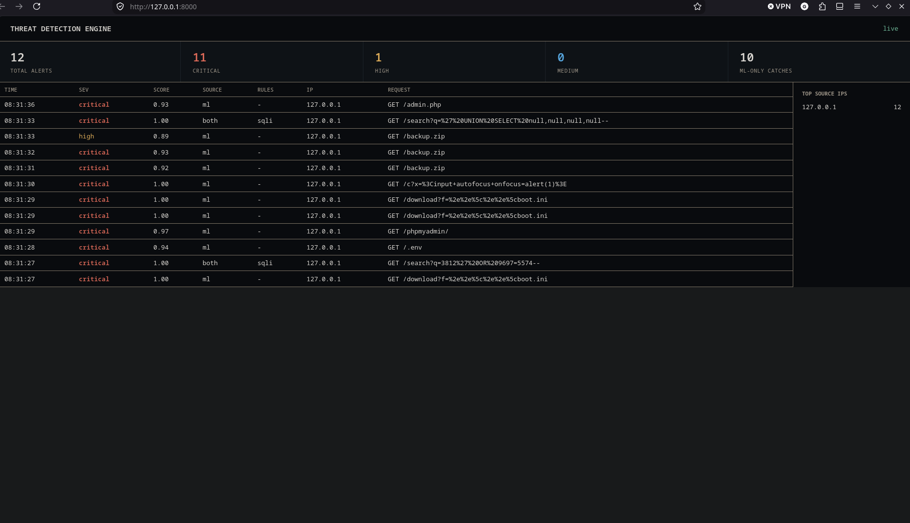

# AI Threat Detection Engine

Real-time web attack detection: Nginx-style access logs go in, scored alerts come out
on a live dashboard. Regex rules catch known patterns; an ML ensemble catches what the
rules miss (evasive payloads, scanner recon).

**Status:** complete (Day 7 of 7). Detection beyond the covered families is future work.



## Pipeline

## Results

### Synthetic dataset (6000 rows, 25% held out): optimistic by design

| Model | Precision | Recall | F1 |
|---|---|---|---|
| Rules only | 1.0 | 0.796 | 0.8864 |
| Random Forest | 1.0 | 1.0 | 1.0 |
| Isolation Forest | 0.8946 | 0.7013 | 0.7862 |
| **Ensemble (0.7 RF + 0.3 IF)** | 0.9987 | 1.0 | 0.9993 |

Recall by family (rules -> ensemble): classic 100.0% -> 100.0%,
evasive 56.3% -> 100.0%,
recon 82.7% -> 100.0%.
These requests come from the same templates as the training data, so treat them as a pipeline
check, not as accuracy. A Random Forest trained without any evasive samples still caught
**66.1%** of them.

### Hand-written holdout sets: the honest numbers

Each set was written by hand before the change it measures. Cells are attacks detected / false positives.

| Set | Round 1 (rules + 22 features) | Round 2 (+6 features, wider data) | Round 3 (+ deterministic rules) |
|---|---|---|---|
| v1 (12 benign, 12 attacks) | 8/12 / 1/12 | 10/12 / 1/12 | 12/12 / 1/12 |
| v2 (12 benign, 12 attacks) | 5/12 / 0/12 | 6/12 / 1/12 | 12/12 / 1/12 |
| **v3 (12 benign, 14 attacks)** | n/a | 6/14 / 2/12 | **11/14 / 2/12** |

v1 and v2 became development sets once I used their misses to drive the next round, so **v3 is
the headline number**. Its attack list includes 4 families the engine was deliberately not built
for (template injection, command injection, LDAP injection, CRLF injection).

### What the iterations showed
- ML features alone barely moved the holdout numbers: round 2 gained one attack and cost one
  false alarm. The misses were specific strings (admin panel paths, `[$ne]` operators), which
  are a lookup problem, not a statistical one.
- Splitting the work fixed it: deterministic rules for known signatures, ML for obfuscation
  and unusual structure. In round 3 the new rules added no false positives.
- The layers cover each other: some attacks only rules catch, others only ML.

## Run

```bash
python -m venv .venv && source .venv/bin/activate
pip install -r requirements.txt
python -m app.gen_dataset && python -m app.train
python -m app.stub_server            # target, writes logs/access.log
uvicorn app.api:app --port 8000      # engine + dashboard at http://localhost:8000
python -m app.sim 60                 # demo traffic
```

## Limitations

- The synthetic dataset is templated, so its near-perfect scores describe that distribution only.
  The hand-written holdout sets are small (12 to 14 attacks), so one request moves a number by
  about 8 points. Treat them as indicative, not statistical.
- Known false positives (ML layer, score about 0.6): a legitimate redirect to a full URL, and a
  `wp-content/uploads` image. Both likely trace to round-2 features and have not been tuned
  away, to keep the v3 evaluation honest.
- Not covered: template injection, command injection, LDAP injection. Features and rules for
  them were not built.
- Alert storage is SQLite and fan-out is in-process; `Store` isolates a swap to Postgres/Redis.
- ONNX export is planned; models are served with joblib.
